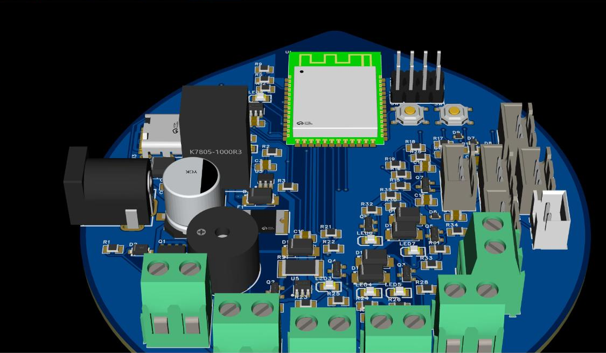
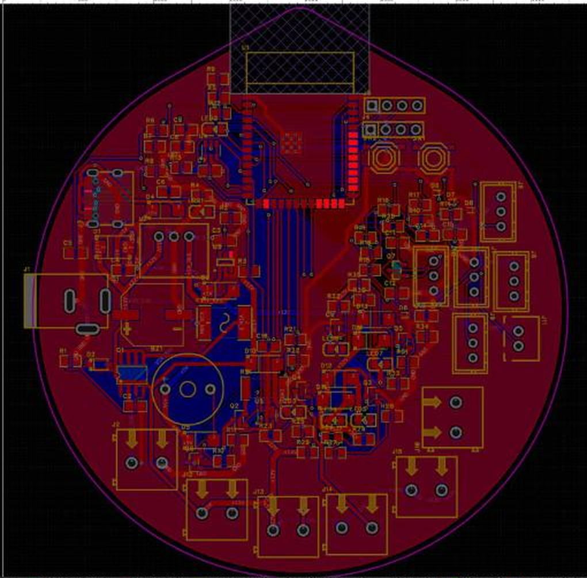
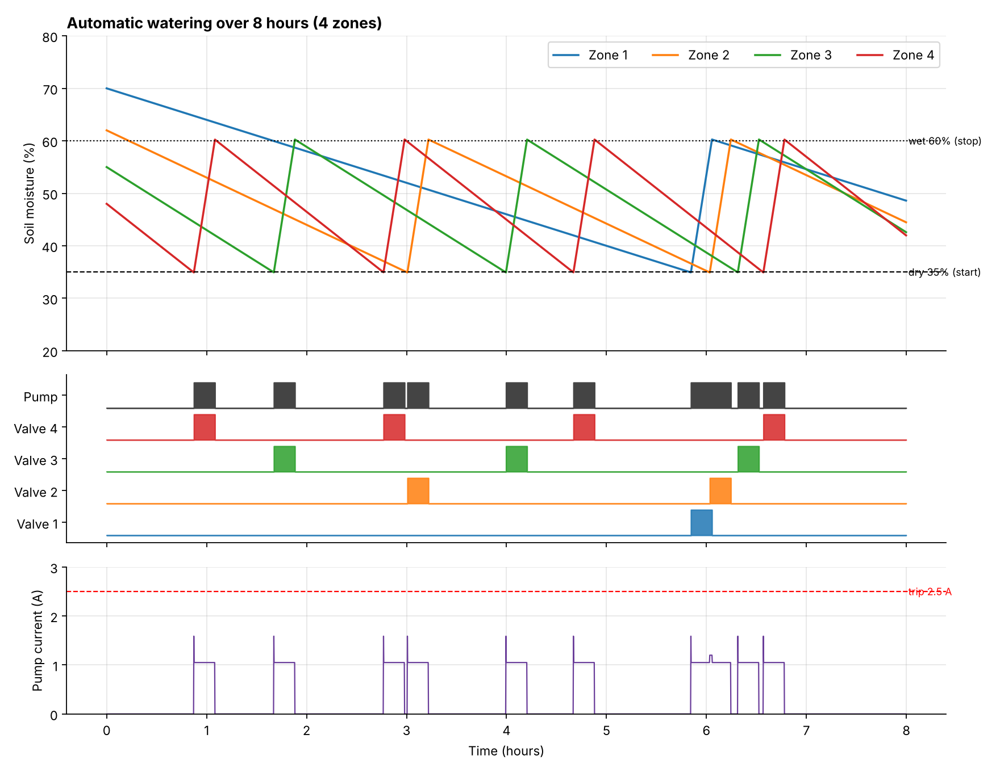
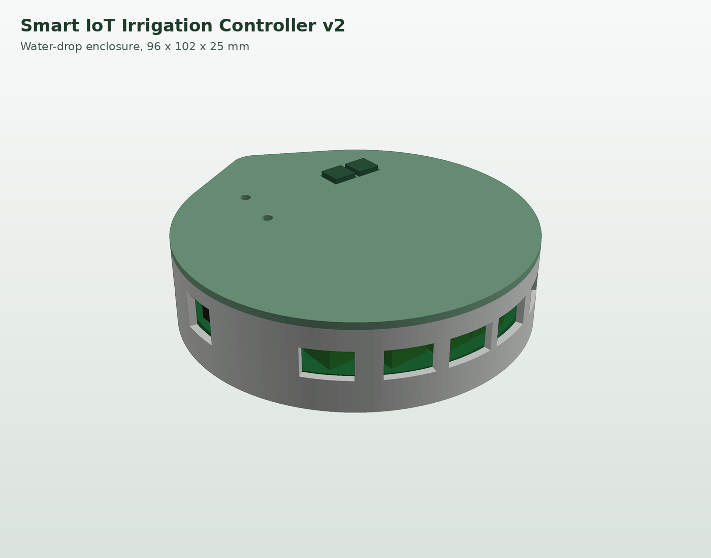

# Smart IoT Irrigation Controller v2

A four-zone garden watering controller built around the ESP32-S3. It reads four soil-moisture sensors and a DHT11, decides which zones need water, and runs a 12 V pump through four solenoid valves. You can watch it and take over from your phone through Blynk.

This repo has everything for v2: firmware, the PCB (EasyEDA, KiCad and Altium), simulations, test results, a 3D-printable enclosure and the full technical report.



## What it does

- Waters each zone on its own. A zone starts below 35 % moisture and stops above 60 % (both adjustable from Blynk).
- Opens at most two valves at once, so the 12 V 3 A adapter is never overloaded.
- Soft-starts the pump over 500 ms with 20 kHz PWM, which cut the start-up peak from 2.98 A to 1.62 A in the performance model.
- Measures pump current with a 20 mΩ shunt and an INA181, and stops the pump within 250 ms on:
  - overcurrent above 2.5 A (jammed pump),
  - dry run below 0.25 A (empty tank),
  - supply voltage outside 10.5–13.8 V.
- Caps every watering run at 20 minutes in case a sensor fails.
- Has three modes (auto, manual and off), a MODE button, a buzzer for faults and a Wi-Fi status LED.

## Hardware

- **MCU:** ESP32-S3-WROOM-1-N8
- **Inputs:** 4 capacitive soil-moisture sensors (power switched by a P-FET to cut corrosion and current), DHT11, supply sense divider (100k/22k), pump current sense
- **Outputs:** 12 V DC pump (PWM low-side MOSFET), 4 × 12 V solenoid valves, buzzer, LEDs
- **Board:** round "water-drop" PCB, routed in EasyEDA Pro with 0 DRC errors and 100 % of nets routed. The DC jack faces left.



## Repository layout

| Folder | What's inside |
|---|---|
| `firmware/` | PlatformIO project (Arduino on ESP32-S3) |
| `hardware/easyeda-fab/` | Gerbers, BOM and pick-and-place exported from EasyEDA Pro |
| `hardware/kicad/` | KiCad 10 project (schematic sheets, PCB, symbol library) |
| `hardware/altium/` | Original Altium schematic and PCB |
| `hardware/3d/` | STEP model of the assembled board |
| `simulation/wokwi/` | Wokwi ESP32-S3 simulation (sketch, diagram, libraries) |
| `simulation/proteus/` | Proteus project, test hex and the automated test runner |
| `simulation/avr-emulator/` | Python AVR emulator used to run the Proteus test firmware and measure timing |
| `simulation/performance-model/` | Software-in-the-loop C++ model built on the real firmware logic, plus the CSV output |
| `results/` | Test results workbook and performance graphs |
| `docs/` | Technical report (PDF) |
| `enclosure/` | STL files, renders, and the FreeCAD and Fusion 360 sources |
| `images/` | Board and circuit pictures |

## Building the firmware

1. Install [PlatformIO](https://platformio.org/).
2. Copy `firmware/include/secrets.example.h` to `firmware/include/secrets.h` and put in your Wi-Fi name, password and Blynk token. `secrets.h` is git-ignored, so it won't be committed.
3. From `firmware/`, run `pio run -t upload`.

Pin assignments and every limit live in `firmware/include/config.h`.

### Blynk virtual pins

| Pin | Use |
|---|---|
| V0–V3 | Moisture % for zones 1–4 |
| V4, V5 | Temperature, humidity |
| V6 | Supply voltage |
| V7 | Pump current |
| V8 | Mode (0 auto, 1 manual, 2 off) |
| V9 | Fault code |
| V10–V13 | Manual valve switches |

## Simulation and testing

- **Wokwi:** open a new ESP32-S3 project and paste in the three files from `simulation/wokwi/`. The pots stand in for the sensors. See that folder's README for the pin map.
- **Proteus:** `simulation/proteus/Irrigation_v2_Sim.pdsprj` runs a stepped test of the pump, valve and alarm outputs.
- **Performance model:** Wokwi only runs at about 3 % of real time, so long runs (an 8-hour watering day, a jammed pump, a dry tank) were done in the C++ model.

```bash
cd simulation/performance-model
g++ -O2 -o sim sim.cpp && ./sim && python3 plot.py
```

| Result | Value |
|---|---|
| Most valves open at once | 2 (limit 2) |
| Peak running current | 1.59 A (limit 2.5 A) |
| Soft-start peak | 1.62 A (2.98 A hard start) |
| Dry-run, overcurrent and low-supply trip time | 250 ms |
| Faults in a normal 8-hour run | 0 |



The full method and results are in [docs/Irrigation_v2_Technical_Report.pdf](docs/Irrigation_v2_Technical_Report.pdf).

## Enclosure

A two-part printed case with button plungers. The STLs are in `enclosure/stl/`.



## Author

Mohammed Olamilekan Aliyu, Electronics Engineer
