# Smart IoT Irrigation Controller v2

A four-zone garden watering controller built around the ESP32-S3. It reads four soil-moisture sensors and a DHT11, decides which zones need water, and runs a 12 V pump through four solenoid valves. You can watch it and take over from your phone through Blynk.

This repo has everything for v2: firmware, the PCB, simulations, test results and the technical report.

The current board is **Rev B**, a 100 × 75 mm rectangular board redrawn from the schematic up. The first board (Rev A, the round one) is still here for reference.

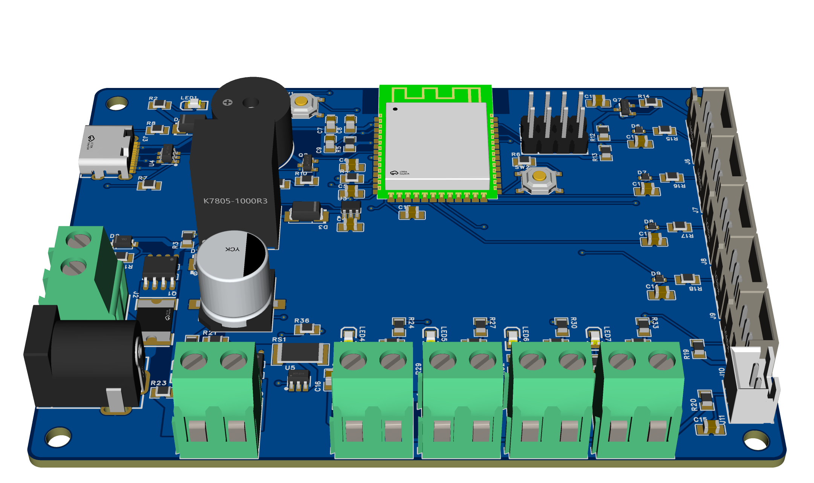

## What it does

- Waters each zone on its own. A zone starts below 35 % moisture and stops above 60 % (both adjustable from Blynk).
- Opens at most two valves at once, so the 12 V 3 A adapter is never overloaded.
- Soft-starts the pump over 500 ms with 20 kHz PWM, which cut the start-up peak from 2.98 A to 1.62 A in the performance model.
- Checks the current on every step of the soft start, so a stalled pump is stopped during the ramp (2.54 A after 429 ms in the model).
- Measures pump current with a 20 mΩ shunt and an INA181, and stops the pump within 250 ms on:
  - overcurrent above 2.5 A (jammed pump),
  - dry run below 0.25 A (empty tank),
  - supply voltage outside 10.5–13.8 V.
- Caps every watering run at 20 minutes in case a sensor fails.
- Skips a zone whose soil sensor is shorted, open or unplugged.
- Has three modes (auto, manual and off), a MODE button, a buzzer for faults and a Wi-Fi status LED.

## Hardware

- **MCU:** ESP32-S3-WROOM-1-N8
- **Inputs:** 4 capacitive soil-moisture sensors (power switched by a P-FET to cut corrosion and current), DHT11, supply sense divider (100k/22k), pump current sense
- **Outputs:** 12 V DC pump (PWM low-side MOSFET), 4 × 12 V solenoid valves, buzzer, LEDs
- **Board (Rev B):** 100 × 75 mm rectangle with four M3 mounting holes, routed in EasyEDA Pro with 0 DRC errors and 100 % of nets routed. The DC jack and USB-C face out of the left edge, the pump and valve terminals are along the bottom edge, and the sensor connectors are on the right. The antenna sits at the top edge over a copper keep-out.

### What changed from Rev A to Rev B

- Pump MOSFET changed from AO3400A (SOT-23) to AO4404B (SOIC-8) for more current and heat margin.
- A 1 kΩ + 100 nF filter was added on the current-sense output, because the shunt only carries current during the PWM on-time.
- High-current tracks are 1.4–1.5 mm wide with no vias. Power parts are grouped on the left, away from the antenna and the sensor inputs.
- Unused pins are marked no-connect, and the board has mounting holes.
- Pin assignments are the same, so the pin map in `config.h` did not change.

The schematic is in [hardware/rev-b/schematic/RevB_Schematic.pdf](hardware/rev-b/schematic/RevB_Schematic.pdf). All 7 sheets:

**Sheet 1: Power input**

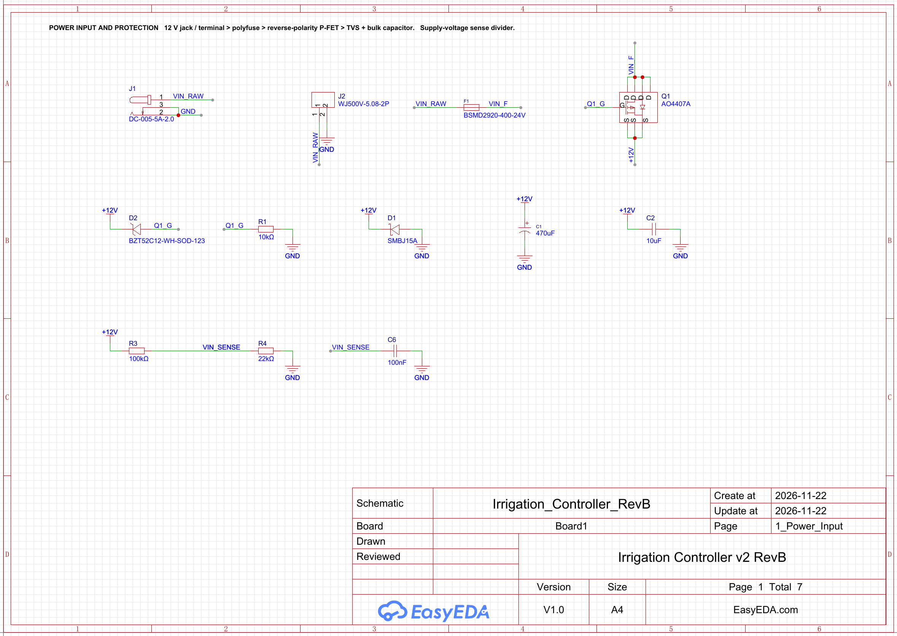

**Sheet 2: Regulators and USB**

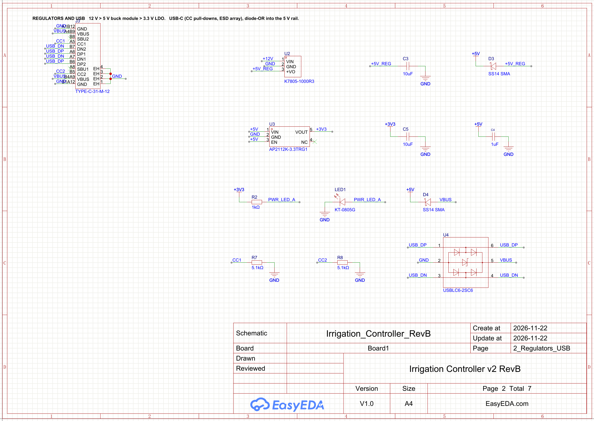

**Sheet 3: ESP32-S3**

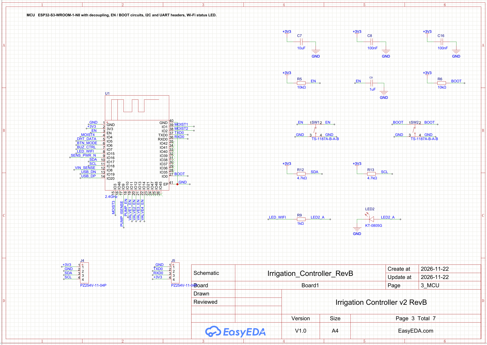

**Sheet 4: Soil sensors and DHT11**

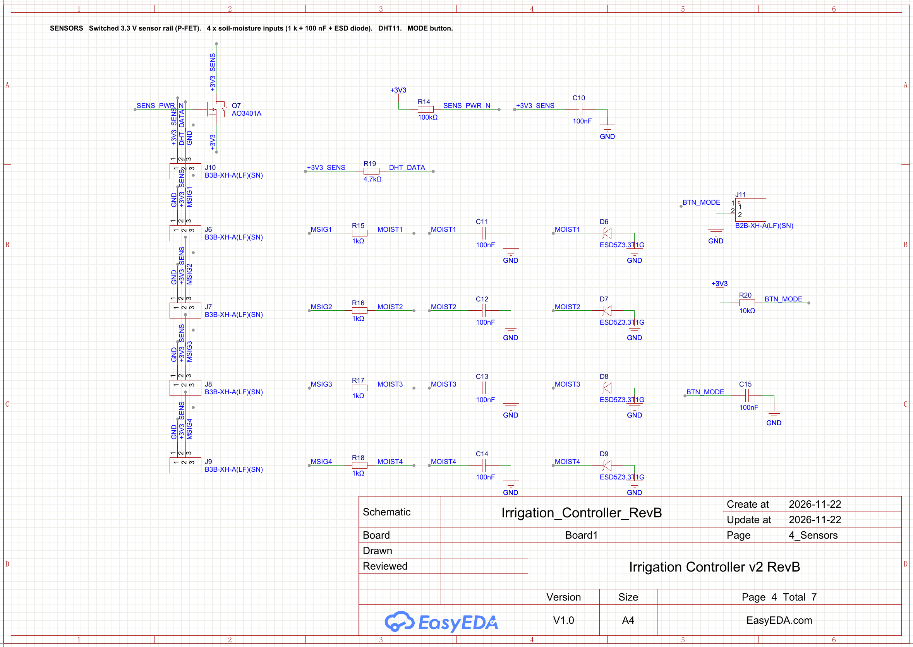

**Sheet 5: Pump driver and buzzer**

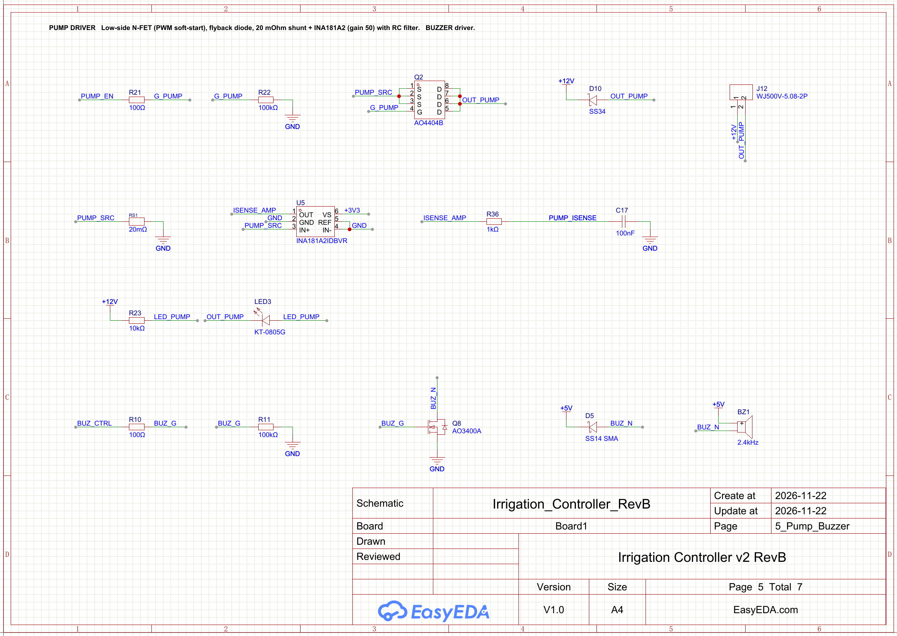

**Sheet 6: Valves 1 and 2**


**Sheet 7: Valves 3 and 4**

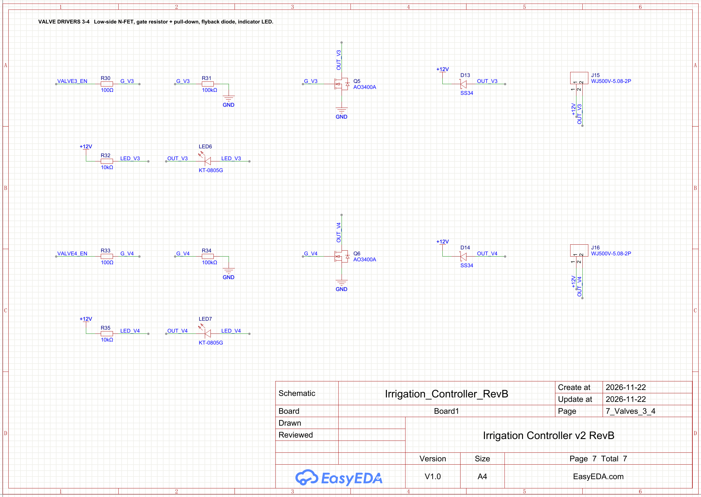

The routed board, with the top copper in red, the bottom copper in blue and the ground pours on both layers:

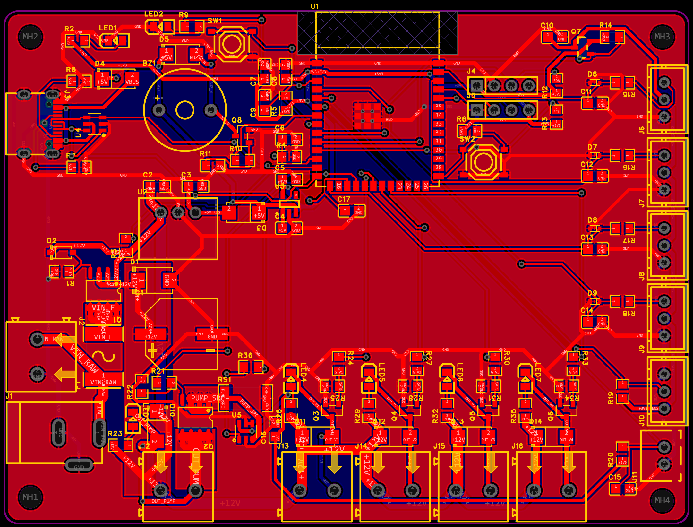

## Repository layout

| Folder | What's inside |
|---|---|
| `firmware/` | PlatformIO project (Arduino on ESP32-S3) |
| `hardware/rev-b/fab/` | Rev B Gerbers, BOM and pick-and-place from EasyEDA Pro |
| `hardware/rev-b/schematic/` | Rev B schematic, PDF and one PNG per sheet |
| `hardware/rev-a-fab/` | Rev A (round board) Gerbers, BOM and pick-and-place |
| `hardware/kicad/` | Rev A KiCad 10 project |
| `hardware/altium/` | Rev A Altium schematic and PCB |
| `hardware/3d/` | Rev A STEP model |
| `simulation/wokwi/` | Wokwi ESP32-S3 simulation (sketch, diagram, libraries) |
| `simulation/proteus/` | Proteus project, test hex and the automated test runner |
| `simulation/avr-emulator/` | Python AVR emulator used to run the Proteus test firmware and measure timing |
| `simulation/performance-model/` | Plant model in C++ that is compiled with the real firmware sources, plus the CSV output |
| `results/` | Test results workbook and performance graphs |
| `docs/` | Technical report for Rev A (PDF) and the Rev B change notes |
| `images/` | Board and circuit pictures |

## Building the firmware

1. Install [PlatformIO](https://platformio.org/).
2. Copy `firmware/include/secrets.example.h` to `firmware/include/secrets.h` and put in your Wi-Fi name, password and Blynk token. `secrets.h` is git-ignored, so it won't be committed.
3. From `firmware/`, run `pio run -t upload`.

Pin assignments and every limit live in `firmware/include/config.h`.

### Blynk virtual pins

| Pin | Use |
|---|---|
| V0–V3 | Moisture % for zones 1–4 |
| V4, V5 | Temperature, humidity |
| V6 | Supply voltage |
| V7 | Pump current |
| V8 | Mode (0 auto, 1 manual, 2 off) |
| V9 | Fault code |
| V10–V13 | Manual valve switches |
| V14, V15 | Dry and wet thresholds |
| V16 | Clear fault |

## Simulation and testing

- **Wokwi:** open a new ESP32-S3 project and paste in the three files from `simulation/wokwi/`. The pots stand in for the sensors. See that folder's README for the pin map.
- **Proteus:** `simulation/proteus/Irrigation_v2_Sim.pdsprj` runs a stepped test of the pump, valve and alarm outputs.
- **Performance model:** Wokwi only runs at about 3 % of real time, so long runs (an 8-hour watering day, a jammed pump, a dry tank) were done in the C++ model.

```bash
cd simulation/performance-model
F=../../firmware
g++ -O2 -std=c++17 -DREVA -o simA sim.cpp && ./simA
g++ -O2 -std=c++17 -Istub -I$F/include -o sim sim.cpp $F/src/sensors.cpp $F/src/outputs.cpp $F/src/zones.cpp && ./sim
python3 plot.py
```

| Result | Value |
|---|---|
| Most valves open at once | 2 (limit 2) |
| Peak running current | 1.59 A (limit 2.5 A) |
| Soft-start peak | 1.62 A (2.98 A hard start) |
| Dry-run and overcurrent trip time | 250 ms |
| Low-supply trip time | 200–250 ms, tested at 8 points of the 10 s sensor period |
| Faults in a normal 8-hour run | 0 |
| Current-sense error during soft start | 0.01 A mean on Rev B (0.34 A on Rev A) |
| Stalled pump at start-up | stopped at 2.54 A after 429 ms on Rev B (2.94 A, 499 ms on Rev A) |

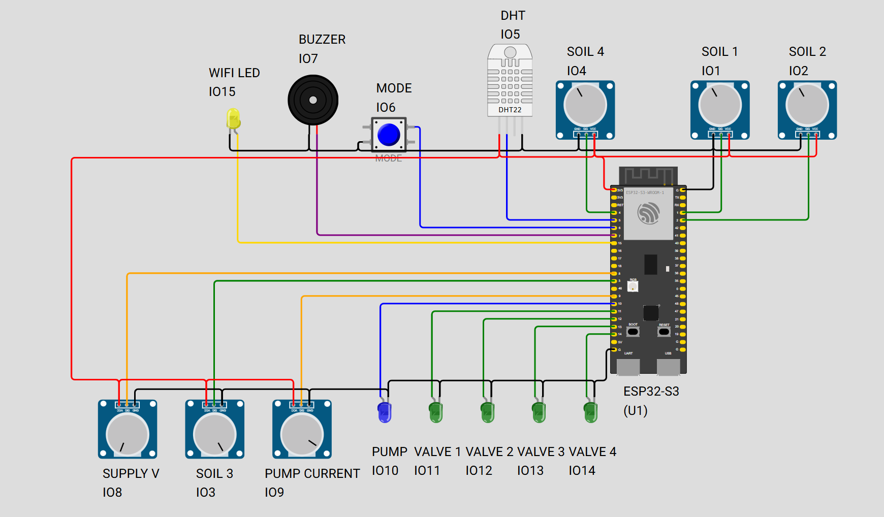

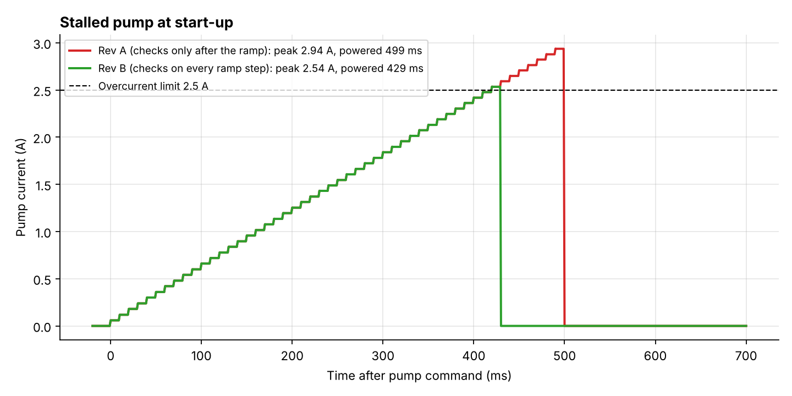

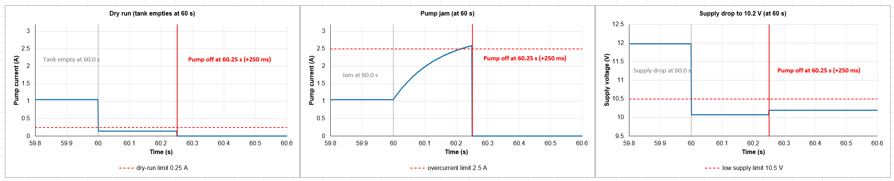

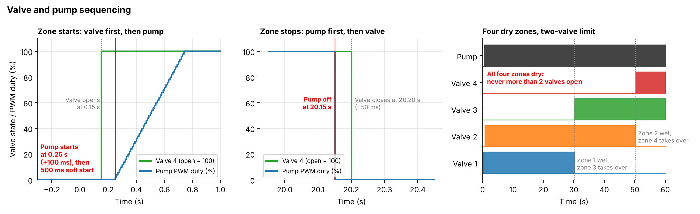

These numbers come from the model. The Rev B sketch compiles and runs in Wokwi (steady readings, no fault), but the fault tests were not repeated there. The firmware has not been built with PlatformIO or run on a board yet, and Proteus was last run on the Rev A code.

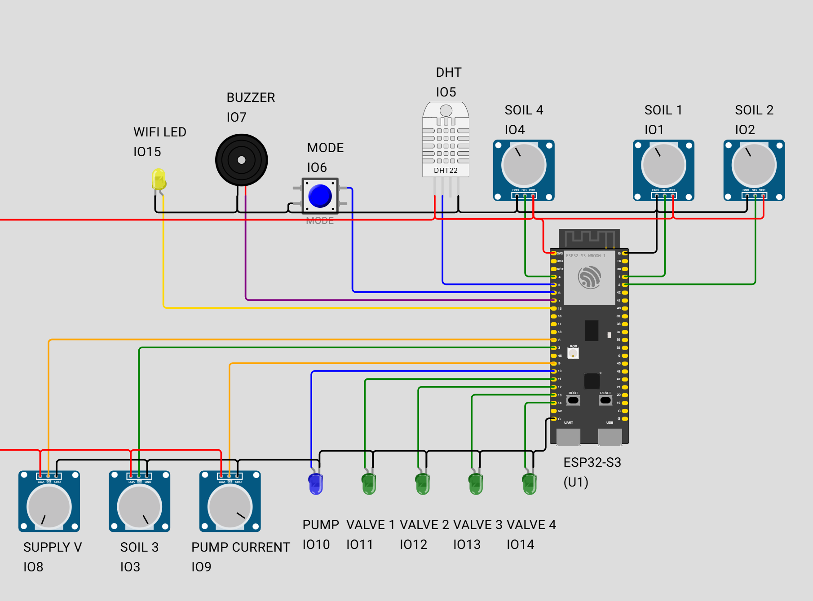

The full write-up, including Rev B, is in [docs/Technical_Report_RevB.pdf](docs/Technical_Report_RevB.pdf). The Rev B changes are also listed in [docs/CHANGES_RevB.md](docs/CHANGES_RevB.md).

## Author

Mohammed Olamilekan Aliyu, Electronics Engineer
